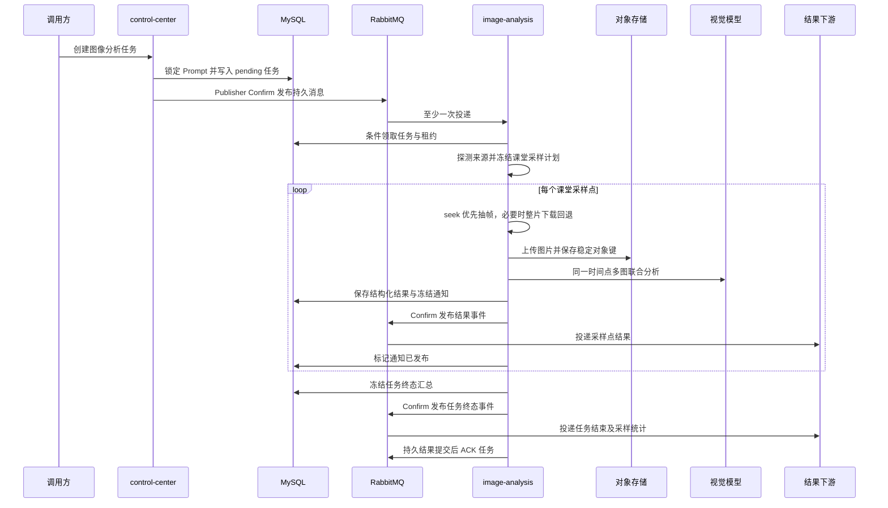

# 课堂图像分析架构

## 1. 目标与边界

课堂图像分析从一组录像或可读取的视频地址中选择时间轴可信的来源，在统一课堂时间点抽取
多路图片，通过视觉模型生成结构化指标，并将每个采样点的结果可靠发布给下游。

职责按服务分开：

- `control-center` 校验请求、锁定已发布 Prompt、创建 `media_task` 并发布任务消息。
- `image-analysis` 探测和读取视频、运行 FFmpeg、访问对象存储、调用视觉模型并发布结果。
- MySQL 保存任务、来源、采样点、图片和通知投递状态，是恢复与幂等判断的事实来源。
- RabbitMQ 只负责至少一次传输，不能替代 MySQL 的任务状态。

控制中心不读取录像文件、不运行 FFmpeg，也不持有视觉模型凭据。

## 2. 接口与消息拓扑

调用方使用内部认证请求：

```text
POST /api/v1/tasks/image-analysis
```

请求契约定义在 `media_platform/contracts/image_analysis.py`。幂等键由学校码、任务类型和
`messageId` 生成；相同幂等键但业务内容变化时拒绝覆盖，避免一次业务任务被静默改写。

任务消息拓扑：

| 用途 | 名称 |
| --- | --- |
| 主 Exchange | `image.analysis.task` |
| 重试 Exchange | `image.analysis.task.retry` |
| 死信 Exchange | `image.analysis.task.dlx` |
| 共享持久队列 | `image-analysis.tasks` |
| 任务 Routing Key | `image.#` |

结果默认发布到 Direct Exchange `image.analysis.result`，Routing Key 为
`image.analysis.sample`。采样事件的 AMQP `type` 为 `image.analysis.sample`，任务终态事件为
`image.analysis.task.terminated`。Exchange 和 Routing Key 可以通过环境变量覆盖，但部署时
必须预先建立有效下游绑定。发布器开启 Publisher Confirm 和 `mandatory`；无路由或未确认
都视为失败，MySQL 中的通知状态会保留，后台扫描后再次投递。

采样事件使用 `eventType=SAMPLE_RESULT`，包含内部任务、采样点、序号、总数、课堂偏移和
采集时间。任务完成或最终失败后创建唯一的 `eventType=TASK_TERMINATED` 通知意图，汇总状态
为 `COMPLETED`、`PARTIAL` 或 `FAILED`，并携带成功、失败、不可用、已发布和发布失败数量。
任务终态事件只有在本任务全部采样通知进入 `PUBLISHED` 或 `FAILED` 后才允许发布。

## 3. 执行链路



来源选择先比较录像覆盖范围、时长和时间轴可信度。入选集合一旦冻结，同一课堂的采样计划
不随进程重启改变。HTTP seek 失败按视频级预算重试，耗尽后才允许整片下载；所有尝试次数和
下一次重试时间都写入 MySQL。

同一采样点只进行一次联合多图推理。图片检查点只保存存储桶、稳定对象键和内容摘要。
模型临时授权 URL 不得写入日志；发给业务下游的冻结通知当前包含有时效的读取 URL，因此
URL 有效期必须覆盖通知补发窗口，长期中断后的重新签名仍需后续增强。

## 4. 持久化模型

图像分析复用 `media_task` 作为公共任务表，并增加四张检查点和通知表：

| 表 | 保存内容 |
| --- | --- |
| `image_analysis_video` | 原请求视频、探测证据、来源选择、读取模式和重试状态 |
| `image_analysis_sample` | 课堂时间点、锁定 Prompt/模型、联合结果和通知状态 |
| `image_analysis_task_notification` | 每个任务唯一的终态汇总、发布领取租约和尝试次数 |
| `image_analysis_frame` | 每个采样点各来源的目标偏移、实际 PTS、图片对象键和处理状态 |

`prompt_version` 同时承载内容分析和图像分析方案，通过方案类型隔离。图像任务创建时锁定已
发布版本及内容摘要，执行期间发布新 Prompt 不会改变既有任务。

图像检查点由 `20261009_0002_add_image_analysis.py` 创建，任务终态通知由
`20261012_0003_add_image_task_notification.py` 增量创建。新迁移在 MySQL 中读取现有
`media_task.zj` 的长度、字符集和排序规则生成外键列，避免历史环境字符定义不同导致 DDL
失败。生产环境应在受控发布步骤执行 Alembic，避免多个服务副本同时运行 DDL。

## 5. 并发与扩展

每个 `image-analysis` 实例使用独立稳定编号，多个实例竞争同一个持久队列。实例内分别限制：

- 同时处理的课堂数；
- FFmpeg/ffprobe 进程数；
- 整片下载数；
- 图片上传数；
- 在途视觉模型请求数。

RabbitMQ prefetch 与课堂额度一致，取得内存额度后仍要通过 MySQL 条件更新获取任务租约。
进程内信号量只提供反压，不能作为任务所有权依据。

任务重试代次同样以 MySQL 为准。如果处理线程已把 `retry_count` 更新到下一代次，但在重试
消息发布或原消息 ACK 前连接中断，Broker 可能重投旧 attempt。消费者会把落后消息视为
可恢复错误，逐代提升 attempt 直到和 MySQL 一致；任务仍处于 `processing` 时，旧重复消息
继续按忙碌处理，不会抢占当前租约。

## 6. 安全要求

- 视频来源必须同时受主机/CIDR 和端口允许列表约束，禁止任意 URL 访问。
- 模型、MySQL、RabbitMQ 和对象存储凭据只从部署环境注入。
- 日志不得记录带用户信息的 URL、签名查询参数、图片临时 URL 或模型密钥。
- 结果 Exchange 和 Routing Key 使用允许字符校验，不能由任务负载任意指定。
- Bootstrap Prompt 只用于首次初始化。公开发布前应确认其内容可再分发，并通过控制中心管理
  后续版本。

## 7. 启用顺序

1. 构建并部署代码，但保持 `IMAGE_ANALYSIS_INTAKE_ENABLED=false` 和
   `IMAGE_ANALYSIS_CONSUMER_ENABLED=false`。
2. 执行数据库迁移，配置 RabbitMQ 结果绑定、对象存储、视觉模型和视频来源允许列表。
3. 启动图像服务并验证 `/health`，使用隔离数据完成端到端测试。
4. 开启消费者，确认 `/ready`、心跳、任务恢复、重复投递和结果补发正常。
5. 最后开启控制中心接单，并逐步提高并发额度。

关闭接单不会中断已进入队列的任务。紧急停机时先关闭接单，再等待任务排空或根据持久租约
执行受控恢复。
