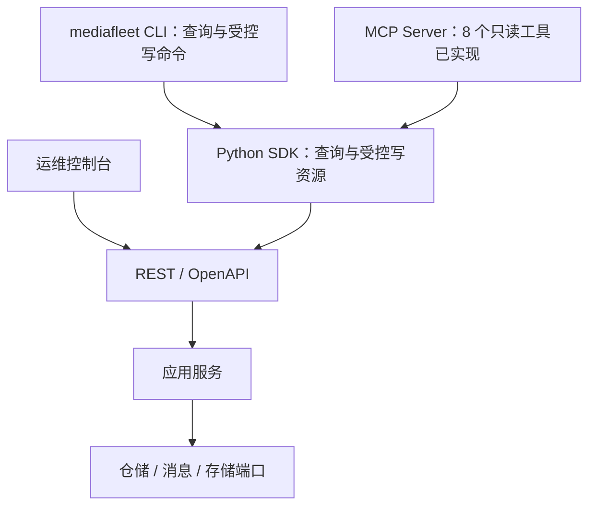

# REST、SDK、CLI 与 MCP 接口架构

MediaFleet 使用一套应用用例和多种入口适配器。REST 是稳定远程契约；Python SDK 封装
REST；CLI、MCP 和现有运维控制台通过 SDK 或相同 REST 语义调用，统一鉴权、授权、审计、
幂等和错误处理。

## 当前接口

控制中心提供任务、节点、心跳、流绑定、录制命令、录制单元、图像分析接单、Prompt 管理
和运维管理 API，并暂时保留部分旧业务兼容路由。图像分析接单默认关闭。OpenAPI 文档默认
位于 `/api/docs`，健康检查位于 `/health`，运维页面位于 `/admin/`。

路由层负责协议解析、鉴权和响应映射；任务创建、调度、状态查询等业务流程应放在应用服务，
便于后续 SDK、CLI、MCP 和测试复用。

## Python SDK

仓库中的 [`packages/mediafleet-sdk`](../../packages/mediafleet-sdk/README.md) 是独立安装包，
发行名为 `mediafleet-sdk`，导入名为 `mediafleet_sdk`。当前提供同步和异步客户端，以及系统、
总览、任务、产物、节点、绑定、录制命令、录制单元和安全管理资源。

SDK 使用 `X-API-Key` 请求头访问受保护接口，提供类型化响应、超时、只读有限重试、分页和
错误分类。服务端无时区时间按 UTC 解释，新增响应字段保持向后兼容。SDK 只依赖 `httpx`
和 `pydantic`，不直接连接 MySQL、RabbitMQ、Redis 或对象存储，也不读取节点本地文件。

SDK 已增加调用方凭据创建、轮换、吊销和审计查询资源，并开放任务创建、失败任务重试、
回调补发、流绑定创建/释放、录制开始/停止和录制服务器状态更新。任务创建要求稳定的
`Idempotency-Key`；其他端点复用服务端已有的业务键或状态迁移幂等语义。所有写请求默认不
自动重试。SDK 当前只在仓库内构建和安装验证，尚未发布到 PyPI。

## CLI

仓库中的 [`packages/mediafleet-cli`](../../packages/mediafleet-cli/README.md) 是独立安装包，
发行名为 `mediafleet-cli`，命令名为 `mediafleet`。CLI 通过同步 SDK 访问控制中心，当前提供：

- 稳定退出码和可机器读取的 `--json` 输出；
- 非交互运行方式，适合 CI 和运维脚本；
- 健康、总览、节点、绑定、任务、产物和录制服务器只读查询；
- 有界分页和任务、绑定筛选参数；
- context、环境变量、自定义 CA 和操作系统凭据库配置；
- 任务、绑定、录制和录制服务器状态的受控写命令；
- JSON 错误写入标准错误，标准输出不混入日志。

非敏感连接配置使用原子写入的 JSON 文件。API Key 只从 `MEDIAFLEET_API_KEY` 或 keyring
读取，不能通过命令值参数传入，也不会保存到配置文件。复杂写请求只接受明确指定的 UTF-8
JSON 文件或标准输入，大小上限为 1 MiB，类型化模型拒绝额外字段。重试、释放、停止录制和
状态变更要求显式传入 `--yes`。

## 调用方身份与授权

控制中心默认保留部署注入的共享 `API_KEY` 作为引导凭据，并新增持久调用方身份和范围化凭据。
范围化密钥采用 `mfk_<credential-id>_<secret>` 格式，服务端按凭据 ID 定位摘要并进行恒定时间
校验，不保存明文。当前权限范围为 `read`、`task:write`、`recording:write`、`node:write` 和
`admin:write`。所有受保护路由先认证身份，再按 HTTP 语义和资源检查范围。

写请求在进入应用服务前持久化审计起始记录；操作完成后补写 HTTP 结果。审计只保存路径、
身份、权限范围和幂等键 SHA-256，不保存查询参数、请求体或凭据。范围化管理凭据和节点凭据
部署并验证后，可以设置 `CONTROL_CENTER_BOOTSTRAP_API_KEY_ENABLED=false` 关闭共享引导密钥。
控制中心关闭前会检查 MySQL 中是否至少存在一个有效的 `admin:write` 凭据；条件不满足时拒绝
启动，避免管理入口永久锁死。

## MCP Server

仓库中的 [`services/mcp_server`](../../services/mcp_server/README.md) 是独立安装包，发行名和
命令名均为 `mediafleet-mcp`。当前使用官方 Python MCP SDK 2.x 和 stdio 传输，并通过异步
MediaFleet SDK 提供健康、总览、任务、产物、节点、绑定和录制服务器共 8 个只读工具。

工具返回稳定的 `ok/data/error` 结构，列表页大小上限为 100，并区分认证、权限、不存在、
冲突、限流、超时、基础设施暂时不可用和 SDK 响应契约错误。任务的任意参数和结果会递归
脱敏与限长；产物不返回签名下载 URL，节点与录制服务器不返回内部管理地址或本地目录。

MCP 进程只从环境读取控制中心地址、API Key、自定义 CA 和超时。当前不提供 Streamable HTTP、
任意 SQL、Shell、文件系统访问、RabbitMQ 发布或环境变量修改工具。变更工具需要范围化授权、
稳定幂等键和可信审计记录后再开放。

## 接口演进

- 新增字段优先保持向后兼容，并为可选字段提供清晰默认语义。
- 删除或改变字段前先标记废弃，说明替代接口和计划移除版本。
- 写操作支持调用方幂等键，避免网络重试重复创建任务。
- 长任务返回 `task_id`，由查询或事件获取结果，不保持长时间 HTTP 连接。
- 所有入口必须经过同一授权和审计边界，不能因 CLI 或 MCP 获得旁路权限。
